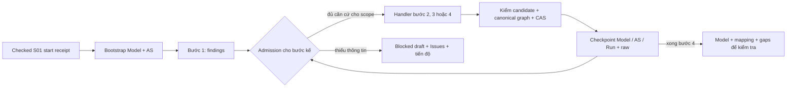

# Đề xuất triển khai phần còn lại 2A — điều phối và handlers bước 1–4

Ngày 23/10/2026 · `s02-2a-execution/0.1.0-draft.2` · **Đã sửa proposal, chờ audit lại; chưa được giao code.**

Đề xuất mốc đầu: **snapshot S01 đã checked + bốn response synthetic → Model, mapping, Issues và tiến độ đọc lại được sau reopen**. Chạy local, cùng SourceContext, trên kho test E1 fresh. Model là bản nháp có truy vết; mock không xác nhận nghiệp vụ. Giữ nguyên DB2, schemas/registry L1–E1, S01 a6, dependencies và các nền tảng đã nghiệm thu. Không provider/LLM, renderer, Answer/application orchestration 2C hoặc 2B.

## 1. Căn cứ và hiện trạng thực tế

Đã đối chiếu [AGENTS](../AGENTS.md), [plan Đợt 2 §2–7, §7.1, §14](S02_PHASE2_IMPLEMENTATION_PLAN_PROPOSAL.md), [amendment A1/A2](S02_PHASE2_CONTRACT_AMENDMENT_PROPOSAL.md) và nguồn LaTeX cập nhật 18/10/2026, mục làm rõ và bước 1–4, qua [đường dẫn nguồn](EXTERNAL_REFERENCES.md). Các mô tả “chưa có profile/migration” trong plan ngày 21/10 là trạng thái lịch sử: P1/P2/P3 nay đã nghiệm thu đúng phạm vi. Không mở lại thiết kế A1/A2 hoặc suy ra toàn 2A đã xong.

Checkout khảo sát: HEAD `4c7e69719dbd1a6e4215cfd01764c6750962ee7f`, worktree sạch trước draft.1. Trước sửa draft.2 đã có proposal chưa tracked và một dòng mục lục docs chưa commit, không có staged diff. Bản trước sửa khớp nguyên byte snapshot của [audit draft.1](/Users/macbookpro/.codex/.chatgpt-projects/g-p-68c38c8799f48191a101e19a975ca4f9/outputs/audits/s02-2a-h1-design-draft1-2026-10-23/AUDIT_REPORT.md); D01/D02 đang chờ auditor kiểm lại phần sửa.

| Đã có trong code | Phần còn phải viết cho đề xuất này |
| --- | --- |
| [S01 adapter](../packages/s02/src/dacn_s02/s01_adapter.py): checked lookup đúng Run/snapshot, archive và kiểm lại nguồn | Bootstrap Model từ inventory; giữ actors supplied, unknowns và Issues công việc |
| [Service.start](../packages/s02/src/dacn_s02/service.py): tạo session/SourceContext, **chưa tạo Model** | Bốn pure handlers, candidate parser/linker và builder Model/Change/Issue/AnalysisSet |
| [Repository](../packages/s02/src/dacn_s02/repository.py): prepare/stages/events, finalize atomic, CAS cặp Model–AnalysisSet, checked read và lost-ACK reconciliation | Điều phối từng checkpoint, admission G2, lưu bản dựng để resume cùng identity |
| [Validators](../packages/s02/src/dacn_s02/validation.py), [whole graph](../packages/s02/src/dacn_s02/profile_graph.py), [closure](../packages/s02/src/dacn_s02/scope.py), [A2](../packages/s02/src/dacn_s02/resolution.py) | Ghép input đúng profile; kiểm projection trước khi đưa batch qua kiểm toàn graph hiện có |
| [CLI](../packages/s02/src/dacn_s02/cli.py): init/start/show và migration; [receipt s02/2](../packages/s02/src/dacn_s02/local_io.py) | bootstrap/analyze-step/resume/progress; xuất model, mapping, gaps và queue câu hỏi |

Không có provider transport, budget ledger hay orchestrator bước 1–4 để chỉ “bật” lên. Không dùng test helpers làm handler production.

## 2. Ranh giới của luồng đầu tiên

- Chỉ nhận receipt `start` đã finalized trên DB2 active E1 test; snapshot được chọn giữ cố định. Không tự tiếp tục `start` chưa hoàn tất: `Service.start` hiện từ chối command đã tồn tại, chưa có intake recovery service.
- Mỗi checkpoint là một operation `work`, parent là checkpoint trước; pin SourceContext và base pair. Mỗi bước chạy một candidate, không tự repair/retry để đoán nghiệp vụ. Candidate mới sau rejection cần command/receipt mới; resume không phải rerun phân tích.
- Bước 1 lưu phát hiện và câu hỏi. Không nhận câu trả lời giả lập như Answer đã áp dụng; không tạo consent, review, S01 revision hoặc source switch. Thông tin chưa đủ giữ Issue và hold.
- Mốc đầu hỗ trợ một lượt 1→4 trên session mới; cả đường thông suốt và đường dừng có checkpoint. Chưa hỗ trợ sửa lại bước đã công bố, hoặc nhận session có Answer/CARRY/REPLACEMENT/Review. Phải từ chối tường minh các ca đó; validators E1 vẫn giữ nguyên khả năng hiện có. Đây là giới hạn entry point mới, không hạ capability của repository.

## 3. Contract candidate đề nghị

Contract mới **chỉ là input riêng của handlers**, ID dự kiến `s02-2a-candidate/0.1.0-draft.1`; chưa đăng ký vào profile/schema canonical. Kế thừa ý tưởng projection trong plan, cụ thể hóa thêm inventory/admission và refs dưới đây để audit trước khi viết schema candidate.

Envelope đóng: `{candidate_version, step, proposals, questions, inspection, unrepresented_source_refs}`. Không nhận Record/envelope của kho. Duplicate JSON keys, field lạ, sai kiểu/exact codec, handle trùng, refs ngoài allowlist hoặc sai snapshot đều reject; giữ nguyên raw bytes, không trim/coerce/điền mặc định nghiệp vụ.

Các kiểu chung:

- `SourceRef` giữ nguyên `{snapshot_id,input_pointer}` của schema hiện hành. Inventory do code lấy từ snapshot: tất cả FR/NFR/constraints **và từng criterion**, giữ thứ tự criteria, priority/null/[] và văn bản nguồn. Ref tới actor/context/điều kiện vận hành cũng phải resolve trong snapshot này.
- `Ref = {local_handle:H} | {base_handle:H}`. Handle mới duy nhất trong candidate; handle base là alias có kiểu do code cung cấp, ghim một logical ID trong base và được lưu cùng checkpoint trước. Ví dụ alias actor supplied ghim `/actors/i`; alias của action bước 2 ghim handle→ID đã công bố. Không nối bằng tên tương tự hoặc index giữa snapshots. Candidate không cấp ID canonical.
- `TraceProposal` giữ `origin`, `source_refs`, `rationale`, `finding_handles`; không có Answer refs trong luồng này. Các field E1 `*_ids` trở thành refs có kiểu, `trace.issue_ids` trở thành finding refs; `handle` thay `id`, Workflow entry/from/to/node/action links cũng dùng Ref. Actor mới không được khai supplied: code đặt kind=candidate. `origin=explicit|inferred` tách khỏi `state=draft|needs_clarification`; code không nâng thành ready/confirmed.
- `Finding` gồm `handle, kind, question, reason, trace, affected_refs, blocking_refs, impact_known`; kind theo Issue hiện hành. Các refs chỉ đề nghị ảnh hưởng: code đối chiếu nguồn, closure và holds. `questions` là danh sách handle của findings cần hỏi nghiệp vụ, không lặp object và không quyết định Issue nào được bỏ khỏi current set.
- `inspection` có đúng một entry mỗi obligation: `{source_ref, read, verdict, needed_facts, evidence_source_refs, finding_handles, reason}`; `read=inspected|not_inspected`, `verdict=usable|held|not_relevant_with_reason`. `not_inspected` phải held; not-relevant cần lý do. Đây là khai báo đã xét trong mock, không chứng minh đọc hiểu hoặc quyền release hold.
- `unrepresented_source_refs` liệt kê nghĩa vụ còn gap ở bước hiện tại; mỗi ref có finding/gap giải thích. Không dùng danh sách này thay inventory hoặc tự coi phần bị bỏ khỏi nó là covered.

Mọi field liệt kê là required; các object đóng, arrays không null. `H` là chuỗi theo mẫu ID S02 hiện hành, chỉ dùng làm handle; `Text` là chuỗi không rỗng đáp ứng codec/schema. Trong Finding: kind/question/reason là chuỗi, trace là TraceProposal, affected/blocking là `Ref[]`, impact_known là boolean. Trong inspection: source_ref là SourceRef; read/verdict là enum nêu trên; needed_facts là `Text[]`, evidence_source_refs là `SourceRef[]`, finding_handles là `H[]`, reason là Text. Questions là `H[]`, unrepresented là `SourceRef[]`. Entity kế thừa E1 giữ types/nullability ngoài những transformations đã nêu; workflow action ref hoặc Part covered_portion/remaining_gap chỉ nhận null đúng nơi E1 cho phép. Schema candidate khi triển khai phải khai báo cả nested refs và các field code sở hữu, không chỉ kiểm envelope.

| Bước | `proposals` đóng và nội dung cho phép | Canonical output và checks chính |
| --- | --- | --- |
| **1 — làm rõ** | `{findings}`. Mỗi finding chỉ ra nguồn, thiếu/mơ hồ/mâu thuẫn hoặc lựa chọn thiết kế và thông tin cần có. Không đề xuất input S01 thay thế | Issue DIRECT + AnalysisSet successor trên Model nền; giữ mọi key hiện hành. Không tự resolve vì candidate không nhắc lại câu hỏi. Business/quality question khác design choice/verification |
| **2 — actors/actions/workflows** | `{findings, actors, actions, workflows, data, rules}`. Entity là projection của Actor/Action/Workflow/Data/Rule E1: bỏ IDs do code quản lý, dùng handle/typed refs/TraceProposal. Workflow vẫn gồm nodes/edges/branch_points; node/edge có local handles | Giữ actors supplied từ S01, actors thêm chỉ candidate. Kiểm initiator/actor, permission-rule kind, read/write, workflow endpoints/guards theo contract hiện có. Quyền chưa rõ: initiator unknown, actor refs rỗng khi phù hợp, Issue/needs_clarification; không suy quyền từ tên. Mapping vẫn có đủ rows not_assessed |
| **3 — components** | `{findings, components, responsibilities, unassigned_actions}`. Component giữ name/purpose/grouping_reason/alternatives/uncertainties; Responsibility giữ statement và component/action/rule refs. Mỗi unassigned action có ref, gap, finding handle | Đối soát actions được phân công hoặc có gap; giữ lý do nhóm/tách và nguồn. Không áp quy tắc mỗi action/entity = component; không tự sinh interface/dependency, công nghệ hay đơn vị triển khai |
| **4 — mapping** | `{findings, mappings}`. Đúng một row mỗi obligation: `source_ref, assessment, parts, finding_handles`. Part giữ obligation/assignment/target, action/responsibility refs, covered_portion/remaining_gap/finding refs và handle | Requirement và criterion có row riêng; row ID do code giữ ổn định theo nguồn. Parts proposed/components cần action + primary responsibility; system không action; blocked/unassigned có gap và Issue phù hợp. Rỗng chỉ not_assessed + Issue. Không có `satisfied`, không ép NFR/constraint thành component |

Các entity/Part không có field ngoài projection của E1 đã nêu; không mở `dict` tùy ý. Bước 2–4 sao chép phần base không thuộc quyền sửa của bước, rồi ghép phần được đề nghị. Nếu Model thay đổi: Model successor + Change `analysis_edit` + AnalysisSet revision 1; chỉ Issues thay đổi thì AnalysisSet successor, không tăng Model vì log. Change operations chỉ dùng element/Part IDs theo contract, không đưa mapping-row ID vào operations. Diffs/impact phải xét Part **cùng mapping source/context**, không so riêng Part JSON hoặc tổng tập nguồn.

## 4. Điều phối và checkpoint



**Bootstrap:** command work base pair null. Model revision 1 giữ actors supplied chính xác và Trace `/actors/i`; các tập phân tích khác rỗng. Mỗi obligation có mapping row `parts=[]`, `not_assessed`, Issue verification “chưa dựng/đối chiếu mapping”. Không giả câu hỏi nghiệp vụ. Model/Issues/AS/Run/config cùng T3; AS có affected đúng toàn bộ elements/Parts hiện có. Không dùng Model rỗng hoặc Scope rỗng thay cho “toàn bộ”.

**Admission G2:** manifest có version/hash ghim source, step, base pair và result pair, lưu trong bản dựng của checkpoint (§5), lấy inventory + current Issues làm gốc. Các verification task do code tạo để chờ bước 4 không chặn chính công việc dựng bước 2–3; chúng vẫn chặn việc tuyên bố mapping hoàn tất. Không miễn blocker chỉ vì `kind=verification`: phân loại task phải do code tạo và ghim key/predicate, không do mock đổi nhãn.

Business/quality hold hoặc nghĩa vụ chưa được xét không tự thành usable. Chưa rõ impact thì giữ source selector trong manifest, materialize toàn Model/Parts hiện tại và tính lại mỗi lần graph lớn lên. Khi có đủ căn cứ cục bộ, dùng closure/reverse impact hiện có tới fixed point, mở mọi Part ra **toàn bộ action_ids**, kiểm lại hợp scope. Không kéo toàn bộ actions chỉ vì chung component. Candidate tự khai “independent” không đủ; thiếu căn cứ thì giữ hold. Manifest không là Review và không được ghi đè current Issues.

Mốc đầu chỉ full scope: có hold liên quan bước kế thì dừng sau khi lưu checkpoint blocked, **kể cả đã khoanh được một phần ảnh hưởng**; không lách sang partial continuation của H2. Batch tiếp theo mới cho phần độc lập tiến tiếp theo G2 đầy đủ. Đọc/phân tích nháp để chỉ ra câu hỏi khác với cho scope ấy qua gate. Không gọi `permitted_scope` của gate review để quyết định có được xây model trước review hay không.

**Lineage:** giữ một current Issue mỗi key, không bỏ cả key resolved; đổi Model tạo successor có scopes/refs current và supersedes chính xác. Chỉ code được kết thúc verification task thuần kỹ thuật khi predicate trên graph mới đã được kiểm, với nguồn/evidence đúng phiên bản; việc có ref không chứng minh hoàn tất nghĩa vụ nghiệp vụ. Mock không resolve business/quality Issues, không tạo human review, không sửa task/Change lịch sử. Nhánh lịch sử A2 ở ngoài entry point mốc đầu được từ chối thay vì clone resolution/Answer sang Model mới.

## 5. Raw input, lỗi và resume — dùng nền tảng hiện có

Mock là file bytes do caller cung cấp, có SHA-256 bắt buộc. Primary work config có marker `s02_2a_work_config`, `config_version=s02-2a-work-config/0.1.0-draft.1`, lưu `execution_origin=synthetic_mock`, candidate/handler versions, step, source/base pair, input hash/length/media type, alias allowlist và limits đã resolve (§8); vẫn có `profile_id/contract_version/rules_id` đúng E1. Run bước 1–4 dùng `mode=replay`, `attempts=[]`; không dispatch_intent/response_received, HTTP status giả, model/provider/usage giả. Raw có purpose hiện có `llm_response` nhưng provenance synthetic rõ ràng. Bootstrap là local_code, không có mock/candidate, Run live với attempts rỗng và steps rỗng như công việc code-only; live không có nghĩa gọi LLM. Đây không phải provider replay/capture G3 hoặc ledger G4.

| Điểm bền vững | Hành vi đề nghị |
| --- | --- |
| **Receipt trước effects** | Dùng nguyên s02/2/store identity/path guards. Lệnh tạo mới chỉ tạo file chưa tồn tại. Resume/prepare-work đọc và kiểm receipt cũ, không gọi write_receipt lên file đó. Mất ACK phải checked lookup đúng store/command; không allocate command mới để resume |
| **T0 — prepare** | Reserved Run + operation + **một primary config** + raw stage cùng transaction, **trước parse candidate**. Step nằm trong config vì request work không có field step. Config mới pin bằng prepared StageRef; không trỏ request tới Artifact chưa tồn tại. Chưa có plan trong prepared stage list |
| **Lập bản dựng** | Pure parse/link/build/kiểm projection từ raw stage; seal một bản dựng được chọn ở §5.2. IDs/times chưa seal chỉ là dự kiến; sau seal không allocate lại. started_at đã pin ở T0; ID Run lấy reserved_run_id, không cấp lại khi seal |
| **T3 — finalize** | Promotion raw/config/bản dựng + Run + records + CAS cặp head nguyên transaction hiện có. Repository kiểm toàn graph/owner profiles trước và sau mutation. Bản dựng không là giấy phép bỏ validator/CAS. Finalize đã có kết quả thì trả Run cũ |

### 5.1 Receipt có nhưng chưa prepare — chọn policy A

`resume --receipt` không nhận input mới và không prepare. Checked lookup thành công, đúng store nhưng không có operation: trả `status=not_prepared`, exit **5**, không effects. Đường explicit là **`prepare-work`** (§6), dùng cùng receipt/command, khai báo lại parent, step, raw/hash cho bước 1–4; bootstrap dùng step=bootstrap và không nhận raw. Không overwrite/xóa receipt và không thay schema s02/2. Receipt chưa có operation chưa pin input/step/parent: không thể chứng minh intent trước crash bằng receipt; **T0 commit đầu tiên mới xác lập intent authoritative**.

Receipt-only cũng chưa chứng minh kind=start hay work. Prepare-work là khai báo explicit cho work mới với parent hợp lệ đã finalized, không phải recovery intake. Nếu đã có operation kind=start hoặc ngoài work H1 thì từ chối, không diễn giải lại receipt đó thành work.

Logical intent cần đối soát gồm: store/command/session/parent identity, kind=work, SourceContext, base pair, step, execution origin, candidate/handler versions, raw hash/length/media type (null cho bootstrap), alias allowlist và resolved limits/version. Fingerprint là hash exact-codec của các pins này, lưu trong primary config; khi so sánh vẫn kiểm các giá trị/bytes đã lưu. Không đưa ID/timestamp mới được allocate của bên đang thử vào phép so intent.

**Helper prepare mới, chỉ cho work H1:** trên checked BEGIN IMMEDIATE hiện có, kiểm receipt/store và tra command. Nếu chưa có operation, kiểm parent finalized/current eligibility rồi lập T0 một lần với raw/config và reserved Run; nếu đã có thì kiểm operation cùng primary config/raw, so intent và dùng lại identity đã lưu. Cùng intent trả operation hiện có, không thêm stage/event; khác intent reject exit 2, không sửa gì. Nếu command đã finalized thì trả outcome từ Run cũ; không đòi parent/base còn là head hiện tại để đọc kết quả đã có. Kiểm current eligibility chỉ dành cho insert mới, mọi publication vẫn qua CAS T3. Bootstrap/analyze-step lần đầu dùng cùng helper. Không tách get_command và prepare thành hai transaction để quyết định absent. `Repository.prepare()` hiện tại chỉ insert, **chưa cung cấp** contract retry/đối soát trên; bắt duplicate insert không đủ.

Walkthrough bắt buộc cho receipt→T0:

| Quan sát / cạnh tranh | Kết quả dự kiến |
| --- | --- |
| Process chết sau receipt, trước T0; checked lookup xác nhận absent | resume → not_prepared/5. Caller explicit prepare-work với flags §6 → prepared/0 (chỉ T0); rồi resume chạy tiếp cùng command |
| Lookup DB lỗi, unavailable hoặc commit outcome chưa đối soát được | failed/3, result.reconciliation=unknown; không kết luận absent, không prepare/cấp receipt khác. Giữ identity để checked reconcile lại |
| Process cũ còn sống cùng prepare-work, intent giống nhau | Checked transaction serialize; chỉ một T0/primary config/raw/reserved Run. Bên sau dùng operation thắng rồi resume, không allocate identity thay thế |
| Process cũ/retry cạnh tranh nhưng parent/step/raw/limits khác | T0 nào commit trước là intent được nhận; bên khác rejected/2 với conflict, không đè raw/pins. Trước T0 không có lời hứa receipt đã gắn với một trong hai input |
| T0 commit rồi mất ACK | Checked probe phải tìm và đối soát intent đã commit. Nếu chưa đọc được thì unknown/3; khi đọc được, resume dùng raw đã lưu, không cần file gốc |

### 5.2 Plan envelope và seal

Plan là blob code tạo, purpose=config, marker **`s02_2a_work_plan`**, `plan_version=s02-2a-work-plan/0.1.0-draft.1`; không phải canonical schema mới. Envelope đóng, có profile_id/contract_version/rules_id đúng E1 và các phần required sau:

| Phần | Nội dung ghim |
| --- | --- |
| bindings | Command/session/parent/reserved Run, source/base pair/step, primary config StageRef/hash, raw StageRef/hash/length (null cho bootstrap), intent fingerprint, execution/candidate/handler/limits versions và hashes allowlist/resolved limits |
| allocation | handle→logical ID, record IDs, plan stage/artifact IDs và timestamps code đã chọn; không đổi sau seal |
| candidate_outcome / diagnostics | Valid/blocked/rejected dự kiến và lỗi có kiểm soát; là dự kiến, không phải Run outcome đã commit |
| batch / promotions | Canonical records dự kiến, nguồn bytes từ stages và đích promotion; không nhúng metadata/hash của chính Artifact plan, tránh vòng tự hash |
| admission | Manifest inventory/holds và base/result IDs dự kiến của §4; không tạo Review hay chứng minh publication |

**Helper seal mới:** dùng checked BEGIN IMMEDIATE và lost-ACK probe trên stages/events hiện có. Chỉ nhận work có primary config đúng marker handler; kiểm toàn bộ bindings với operation, raw bytes và profile/versions, không tin plan do caller CLI đưa vào. Tìm plan bằng marker/version trong config stage bytes của command, không parse log text để chọn authority. Plan stage được append **sau T0**, cùng một log thông tin; không đưa nó vào prepared stage list, vốn phải giữ đúng một primary config pin. T3 promote primary config và plan thành hai Artifacts riêng; Run.config_artifact_id vẫn trỏ primary config đã pin.

Các quy tắc đếm plan sau áp dụng khi command **chưa finalized**. Đã finalized thì không gọi lại helper; đọc outcome từ checked Run/event. Các kiểm tra integrity raw/stage/hash của repository vẫn bắt buộc, không được bỏ qua vì Run đã có.

- **0 plan:** validate bản dự kiến, rồi append đúng một plan + log nguyên transaction. Hai builder có thể có IDs/times dự kiến khác nhau trước seal; chỉ bản đã commit có authority.
- **1 plan hợp lệ:** trả nguyên bytes/StageRef đã lưu sau khi kiểm bindings; caller bỏ bản dự kiến riêng, kể cả allocation/timestamps khác. Handler/plan version không hỗ trợ thì dừng rõ, không rebuild, không ghi thêm plan. Bindings sai/hash hỏng thì lỗi integrity.
- **Nhiều plan cùng marker**, hoặc marker đúng nhưng version/shape không đọc được: failed/3, không chọn theo thứ tự/timestamp, không repair/xóa/append bản thay thế. Đây là kiểm tra của entry point H1 cho format blob của nó, không áp schema mới lên work lịch sử khác.
- Crash trước COMMIT không có seal bền vững; crash sau COMMIT/mất ACK phải đọc lại StageRef/bytes đã thắng. Không biết outcome thì unknown/3, không seal mù thêm lần nữa. Không thêm bảng/column/enum/claim/CAS hoặc thay validator lịch sử.

**Authority:** trước finalize, plan chỉ ghim cách dựng lại batch; sau finalized, **Run cùng finalized event và checked head là outcome authoritative**. Progress lấy status/result pair thực từ Run, so với head hiện tại; plan còn giữ IDs dự kiến khi Run stale/rejected/failed không làm chúng thành published Records. Config/log/manifest không được ghi đè kết quả T3.

### 5.3 Resume và lỗi publication

Resume đọc checked command/stages: có T0, chưa seal thì parse/build từ raw đã lưu; đã seal thì dùng lại batch và domain IDs/timestamps đã ghim, không đọc file mock hoặc cấp lại các giá trị đó. Event identity tại transaction commit vẫn do repository hiện có quản lý, không thay IDs/times trong batch. Version không hỗ trợ thì failed/3, không rebuild bằng bản mới. Đã finalized thì trả Run cũ, không thực thi handler lại. Start chưa finalized vẫn ngoài phạm vi work resume.

| Trường hợp | Kết quả; head và bằng chứng |
| --- | --- |
| JSON/candidate/ref không hợp lệ | Run rejected, raw + lỗi parse/schema/ref; không result Model/set, không chạy bước phụ thuộc |
| Candidate hợp lệ nhưng thiếu thông tin | Run blocked có thể công bố draft/AS hợp lệ; holds/gaps còn nguyên; không dùng rejection kỹ thuật để đoán câu trả lời |
| Lỗi builder/whole-graph hoặc I/O | Rollback publication; failed/3 hoặc unknown/3 để checked reconcile. Chỉ finalize failed khi có thể lưu Run không publication hợp lệ; giữ plan/raw kể cả batch dự kiến không được công bố. Không rewrite plan thành công/failed để chạy lại mù |
| Base Model **hoặc AS** đã đổi | Run stale theo finalize hiện có; chỉ giữ artifacts/Run, không ghép vào head mới. Rerun trên base mới là command explicit khác |
| Cùng receipt resume đồng thời | Một bản dựng được seal, một finalized Run; mọi caller trả lại identity đã lưu. Không tự chọn result theo timestamp |

## 6. CLI và đầu ra dự kiến

Các lệnh dưới đây **chưa tồn tại**; tên/flags đưa đi audit. Dùng một checkpoint/receipt mỗi lần để có luồng sớm, chưa cần batch runner hoặc workflow framework. `init`, `start`, `show-*` hiện hành giữ tương thích.

```text
dacn-s02 --config test.toml start --store-key synthetic --s01-run-id <run> --expect-snapshot <snapshot> --receipt <intake.json>
dacn-s02 --config test.toml bootstrap --from-receipt <intake.json> --receipt <bootstrap.json>
dacn-s02 --config test.toml analyze-step --from-receipt <bootstrap.json> --step 1 --mock-response <step1.json> --expect-sha256 <sha256> --receipt <step1.receipt.json>
# Lặp analyze-step cho 2, 3, 4; from-receipt là checkpoint liền trước.
dacn-s02 --config test.toml resume --receipt <stepN.receipt.json>
dacn-s02 --config test.toml progress --receipt <stepN.receipt.json>
# Chỉ khi resume đã trả not_prepared/5 cho receipt work:
dacn-s02 --config test.toml prepare-work --receipt <step1.receipt.json> --from-receipt <bootstrap.json> --step 1 --mock-response <step1.json> --expect-sha256 <sha256>
dacn-s02 --config test.toml resume --receipt <step1.receipt.json>
```

Prepare-work cho bootstrap dùng `--step bootstrap --from-receipt <intake.json> --receipt <bootstrap.json>`, không có mock/hash flags. Lệnh này nhận receipt đã tồn tại để khai báo work explicit theo §5.1, không tạo file receipt; thiếu file là not_found/4. Bootstrap/analyze-step lần đầu vẫn yêu cầu receipt mới; trùng file bị từ chối, không âm thầm chuyển thành prepare-work. Prepare-work trả prepared/0 chỉ nghĩa T0 đã có, không công bố Model/set; nếu operation work đã finalized cùng intent thì trả outcome/exit tương ứng của Run.

`--step` phải đúng bước kế tiếp đã pin, không nhảy/cộng step theo nội dung mock. Receipt cha phải finalized và gắn đúng session/source/base; stale/historical không tự được nâng lên head mới. Trước T0, request explicit bị sai base/eligibility thì rejected/2 không publication; không tự thay parent/base. Progress vẫn đọc được lịch sử, phân biệt result pair của receipt với head pair hiện tại. Các file đầu ra/receipt tuân guards hiện có, không ghi vào dataset/S01 store/checkout hoặc operational state không được giao.

Giữ output envelope `{command_id,status,record_ids,errors,result}`. Trong result có execution_origin, source pins, Model/AS IDs, completed_steps, next_step, holds, mapping inventory/gaps, current Issue IDs/questions và raw/config/plan refs/hashes. Chưa T3 thì record_ids không liệt kê reserved/result IDs như Records đã tồn tại. Progress trả Model cùng bảng requirement/criterion→Part→action/responsibility/component để kiểm. `not_run`, `not_prepared`, `prepared` và reconciliation=unknown thuộc báo cáo CLI, không thêm enum Run/operation. Run completed chỉ nghĩa công việc code hoàn tất; kết quả vẫn draft chưa review.

| CLI status / điều kiện | Exit | Hành vi |
| --- | --- | --- |
| completed; progress đọc được; prepare-work đã có T0 | 0 | Ghi rõ phase=prepared nếu chỉ T0; progress giữ Run outcome trong result, không biến blocked/stale thành completed |
| rejected, blocked cần input, stale/conflict | 2 | Không tự repair/rebase/retry; status và Run outcome đúng thực tế |
| failed/interrupted; lookup/commit outcome unknown; version không hỗ trợ | 3 | Giữ receipt/identity; unknown khác absence đã xác minh, không prepare mới |
| not_found: receipt không tồn tại hoặc lookup ID không tồn tại ngoài nhánh work receipt hợp lệ | 4 | Không tạo receipt thay thế |
| not_prepared: work receipt hợp lệ nhưng checked lookup không có operation | **5** | Resume/progress không effects; chỉ dẫn các args explicit prepare-work, không suy input/parent từ receipt |
| Sai cú pháp/flags (kể cả raw/hash cho bootstrap) | 64 | Không effects |

Receipt malformed/sai store binding là rejected/2; I/O hoặc không kiểm được store là failed/3, không được trả not_prepared/5. Bảng này áp cho lệnh mới, không đổi exit behavior của CLI đã nghiệm thu.

## 7. Mốc nghiệm thu và các đợt nhỏ đề nghị

**M1 là luồng xuyên suốt 1→4, không dừng ở parser hoặc bootstrap riêng.** Có thể chia việc nội bộ nhưng chỉ bàn giao mốc khi chạy được recipe trên, reopen rồi inspect được Model/mapping/Issues. Fixtures synthetic có nguồn đủ rõ cho đường thông suốt; case thiếu thông tin riêng chứng minh dừng và giữ hold.

| Đợt cần giao sau audit | Phạm vi và tiêu chí kết thúc |
| --- | --- |
| **2A-H1 — mốc đầu chạy được và an toàn** | Candidate schemas/linker, bootstrap, bốn handlers/builders, checkpoint/prepare-work/seal/resume, CLI fresh/full scope, limits §8. S01 a6 test store + bốn mock bytes → checked archive, đầy đủ requirement/criterion rows, actors/unknowns, Model/mapping/Issues inspect được. **Toàn bộ ma trận an toàn §7.1 thuộc nghiệm thu H1**, không chỉ happy path + reopen tuần tự; không dùng canonical import thay handlers |
| **2A-H2 — partial scope/G2 mở rộng** | Cho phần độc lập tiến tiếp, holds khi graph lớn, fixed-point/reverse impact giữa scopes; stress matrix ngoài tập tối thiểu H1 (nhiều workers/lượt/checkpoints, graph lớn trong limits). Không hoãn kiểm an toàn của chức năng đã có ở H1 sang H2, không nới gate review/A2 |
| **2A-H3 — checkpoint trên lịch sử E1, nếu chốt nhận phạm vi này** | Builders tiếp nhận current Issues có DIRECT/Answer/CARRY/REPLACEMENT và bảo toàn A2 bằng validators đã nghiệm thu; thiếu proof giữ pending/undetermined/incomplete và full hold. Không sinh Answer/application/review. Đây là mở rộng entry point sau M1, cần giao riêng; chưa làm không được báo toàn bộ điều phối 2A hoàn tất |

Mỗi bản phát hành được giao sau này cần wheel non-editable, venv mới ngoài source từ locks, source–wheel–installed/METADATA/WHEEL, hai backend có instrumentation, full S02/S01 phù hợp, các oracle P1/P2/P3 nguyên byte và differential L1. Đầu ra mới, hashes/diff/logs/JUnit và inventory bảo vệ riêng; không dùng số tests lịch sử làm kết quả mới.

### 7.1 Ma trận bắt buộc trước bàn giao H1 đạt

Đây là yêu cầu kiểm thử **chưa viết/chạy**, thực hiện cả C/Python có instrumentation, bằng process/connection độc lập và fault hooks có bằng chứng. Không được dời những ca này sang H2:

| Ca H1 tối thiểu | Oracle sau reopen / đối soát |
| --- | --- |
| Hai resumers cùng command trước seal, rồi case riêng sau seal | Một plan hợp lệ/StageRef, một reserved/final Run; cùng raw, handle→IDs, timestamps và kết quả T3. Allocation chưa seal của bên thua không thành Records |
| Crash trước/sau receipt creation và T0 COMMIT; lost ACK sau T0 COMMIT | Không receipt/T0 không được báo đã nhận; receipt-only đi đúng not_prepared/5 → explicit prepare-work. Raw/config một lần; lookup unavailable và hai prepare cùng/khác intent đi đúng §5.1 |
| Crash trước/sau seal COMMIT và lost ACK sau COMMIT | Trước COMMIT không có plan bền vững; sau COMMIT dùng nguyên plan đã lưu. Không append bản thứ hai khi ACK mất; probe không được thì unknown/3 |
| Crash trước/sau T3 COMMIT và lost ACK sau COMMIT | Trước COMMIT không publication một phần; sau COMMIT trả Run/head/Records cũ. Raw/plan/IDs/timestamps không đổi, một finalized Run/event |
| Model-head đổi; **case riêng AS-head đổi khi Model giữ nguyên** | CAS stale, không result Model/set, không đụng head mới; chỉ giữ artifacts/Run theo nền tảng hiện có, progress không nhận IDs dự kiến của plan làm published |
| Raw sai JSON/schema/ref; blocked draft; limits vượt | Rejected raw sau T0 vẫn có bằng chứng, không publication hoặc chạy bước phụ thuộc; blocked lưu/reopen giữ holds. Các nhánh giới hạn trước/sau T0 theo §8 |
| Handler/plan version không hỗ trợ; bindings/hash sai; nhiều plan | Dừng rõ, không rebuild/repair/chọn theo timestamp. Finalized outcome hợp lệ vẫn đọc từ Run mà không chạy handler lại |

Mỗi điểm COMMIT cần phân biệt rollback trước commit, commit thành công nhưng process chết, và commit thành công nhưng ACK lỗi; timeout chung không thay được ba bằng chứng này. Với mỗi case, lưu command/receipt/store/source/base, events/stages, plan/raw hashes, IDs/timestamps và head trước/sau; đọc lại bằng connection mới, không chỉ kiểm object còn trong memory.

Controls handlers thuộc H1: sai snapshot/criterion pointer, duplicate handle/foreign ref/field lạ/exact-codec; actor supplied mất/đổi tên, quyền unknown không tự gán; constraint chưa xét giữ hold; requirement có Parts nhưng criterion chưa mapped vẫn thiếu; system Part hợp lệ; Part nhiều actions không cắt để né blocker; full-scope hold không chạy partial. Mapping đổi source/reparent qua reverse impact phải có controls ở phần G2 H2 và giữ oracle A2 hiện hành khi kiểm regression H1. Giữ tests scope/target/operation identity và review lineage đã đóng findings.

## 8. Limits local đề nghị cho H1

Đề nghị profile blob **`s02-2a-local-limits/0.1.0-draft.1`**, không phải profile registry mới. Số sau là trần tài nguyên cho kho synthetic nhỏ, **chưa đo benchmark/chưa được audit chấp thuận**, không ngưỡng chất lượng nghiệp vụ hoặc giới hạn mới của canonical L1/E1.

| Trần đề nghị | Phạm vi/cách tính |
| --- | --- |
| Raw mock **1 MiB** (1.048.576 bytes) mỗi command | Đọc có bound và kiểm SHA trước T0, không truncate. Primary config ≤2 MiB; sealed plan ≤16 MiB, tính theo exact encoded bytes |
| JSON depth **64**, tổng values **100.000** | Root depth=1; đếm mỗi container/scalar một lần trên raw candidate; kiểm depth khi duyệt token có bound trước materialize toàn cây. Chuỗi đơn ≤64 KiB UTF-8 decoded |
| Inventory **1.000 obligations**, **2.000 Model entities** | Inventory gồm requirement + từng criterion; entities đếm toàn collections actors/actions/workflows/data/rules/components/responsibilities/interfaces/dependencies của result Model, không chỉ phần thêm ở lượt này |
| **2.000 workflow nodes**, **4.000 workflow edges**, **4.000 Parts** | Tổng trên result Model, không per workflow/row; không cắt graph/Part để nằm dưới trần |
| **500 findings/candidate**, **2.000 current Issues** | Current set tính cả key resolved còn được chọn; không bỏ history/key để qua trần |
| **50.000 ref occurrences** | Trên từng candidate/result Model+current set: source/handle/typed-element refs, không đếm lại pointer bên trong mỗi SourceRef như ref khác; cap refs trước closure/scope materialization và kiểm bytes plan khi build |
| **30 giây compute/lần lập bản dựng**, một candidate/command, auto-repair=0 | Monotonic deadline kiểm giữa phases và trong loops, gồm parse/link/closure/build/serialize trước seal; không gồm file/SQLite waits. Đây là cooperative bound, không hứa hard timeout cho syscall/hàm nguyên khối. Resume chưa seal có thể tính lại do caller explicit; không ledger cộng thời gian qua các lần restart |

Giá trị H1 là defaults cố định theo version, pin toàn bộ resolved limits và hash trong primary config/plan. Không thêm Settings TOML keys; busy_timeout_ms vẫn dùng cấu hình hiện hành, không resolve dependencies. H1 không cho CLI tăng/vô hiệu trần hoặc reset limits khi resume; muốn đổi defaults phải review/version lại, không âm thầm áp trần mới lên command đã prepared. Fixture kiểm biên trước/sau từng trần và clock injection thuộc H1; hiệu năng thực chưa được chứng minh.

Vượt byte/input/inventory limit trước T0: rejected/2 với LOCAL_LIMIT_EXCEEDED, không prepare/ghi raw bị cắt; receipt đã tạo vẫn là receipt-only và có thể kiểm not_prepared/5. Vượt depth/count/time/encoded plan limit sau T0: giữ raw đầy đủ và primary config; seal bản dựng rejection nhỏ với batch/allocations chỉ cho Run/Artifacts/evidence lỗi, không domain publication, rồi finalize Run rejected không result. Nếu plan rejection nhỏ cũng không lưu được hoặc outcome I/O chưa biết thì failed/unknown/3, không claim đã finalize. Plan thành công đã seal không bị thay bằng rejection plan nếu resumer khác hết thời gian; luôn dùng bản đã thắng. Không tự chia candidate, bỏ criteria, bỏ hold hoặc retry để qua limits.

## 9. Những điểm đưa đi chốt qua audit trước code

1. **Contract candidate và G1/G2:** chốt projection/typed aliases/inspection ở §3, bootstrap và cách phân biệt task kỹ thuật với business hold ở §4. Đề nghị thông qua phạm vi H1 bảo thủ trước; G2 cục bộ ở H2 cần test matrix riêng, không được suy độc lập từ source refs hoặc usable do mock khai.
2. **Resume:** proposal chọn policy A, helper prepare đối soát intent và seal có guard giao dịch ở §5; không thay cấu trúc/semantics storage đã nghiệm thu. Auditor cần xem hợp đồng này trước implementation; prepare/append_event hiện hành chưa tự có các bảo đảm helper mới. Ma trận an toàn ở §7.1 là gate H1.
3. **UX/phạm vi:** chốt lệnh mới/exit codes ở §6 và một lượt fresh/full scope trước; H3 vẫn cần giao riêng. Intake recovery, sửa bước đã công bố và source switch chưa thuộc mốc đầu. CLI mock không thành endpoint nhập arbitrary Records.
4. **Giới hạn local:** chốt defaults/cách pin/vượt trần ở §8. Đây là đề xuất có số cụ thể, chưa là số được đo hoặc được nghiệm thu; không thêm retry, token/cost ledger hay ngưỡng chất lượng nghiệp vụ.

## 10. Delta draft.1 → draft.2 để audit lại

- **D01:** chuyển toàn bộ kiểm chứng resume/race/crash/lost ACK/T0–seal–T3/stale Model và AS/version/reopen vào gate H1 (§7.1); H2 chỉ partial G2 và stress ngoài tập đó.
- **D02:** chọn policy A (§5.1), explicit prepare-work dùng receipt cũ, đối soát intent/first T0 commit, walkthrough receipt-only/race/unknown; not_prepared exit 5 và CLI/exit table ở §6.
- Làm rõ plan marker/envelope/0–1–nhiều/primary pin và authority Run sau finalized (§5.2); bổ sung types/nullability candidate (§3), trần local có số và cách xử lý vượt (§8).
- Giữ nguyên mốc S01 + bốn mock → Model/mapping/Issues và ranh giới fresh/full-scope/offline; không ghi D01/D02 đã được auditor đóng. Diff/hashes và kiểm bảo toàn tại [bàn giao draft.2](../reports/s02-phase2/2a-h1-design-draft2-2026-10-23/START_HERE.md).

Lượt này chỉ khảo sát code và viết thiết kế; chưa có handlers/candidate schemas/CLI mới, chưa chạy pipeline, tests, build hoặc migration. Chưa có đánh giá ngữ nghĩa, LLM, renderer hoặc nghiệm thu implementation. **Bàn giao để audit thiết kế; sau audit cần người dùng giao implementation từng đợt. Không commit/push.**
